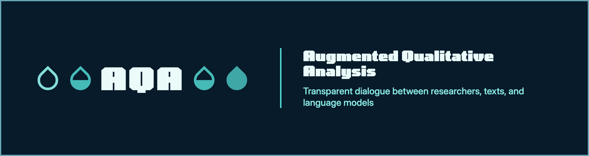
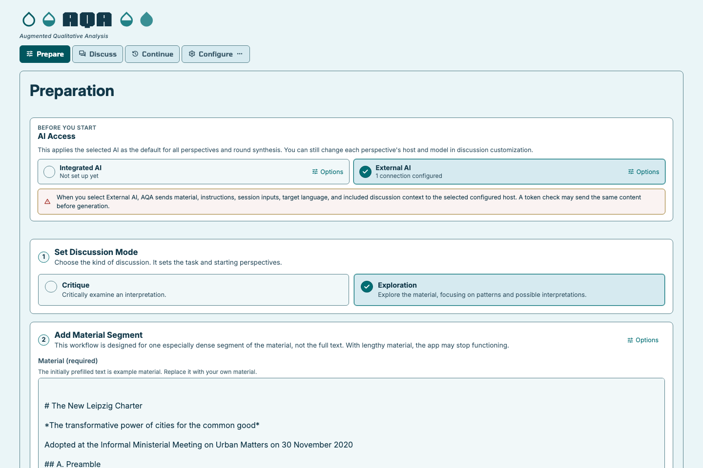
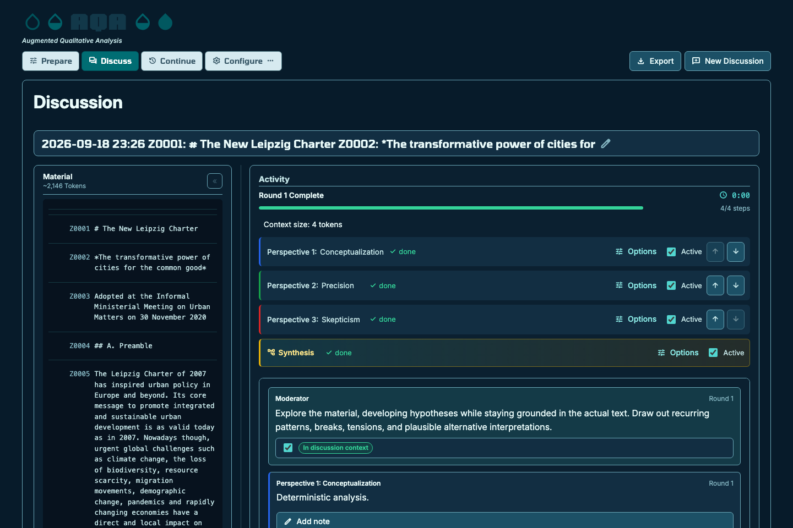
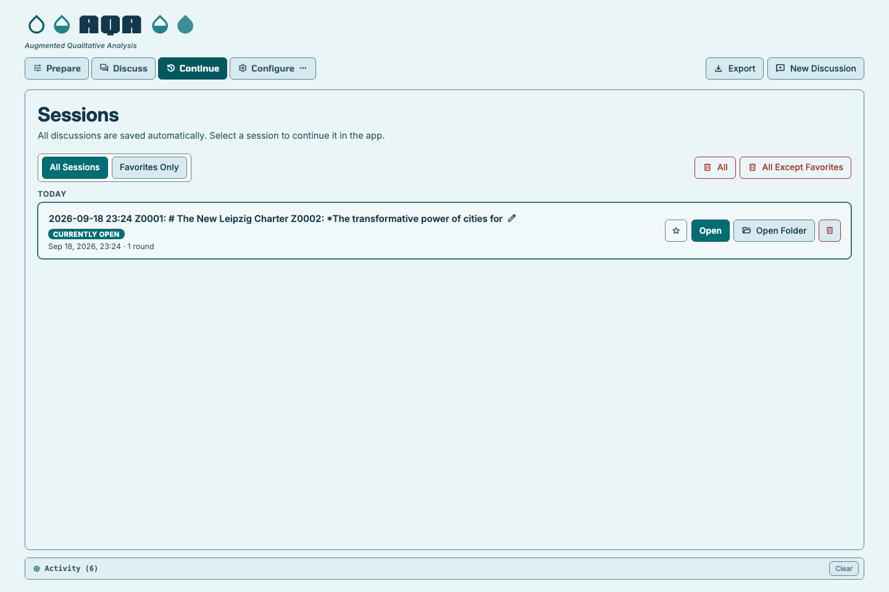
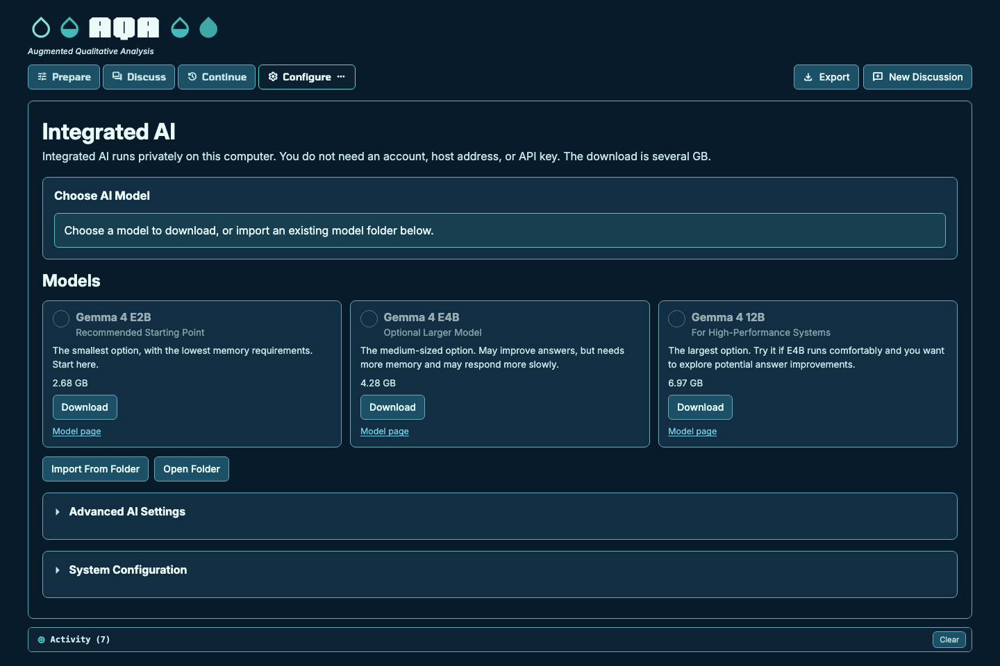
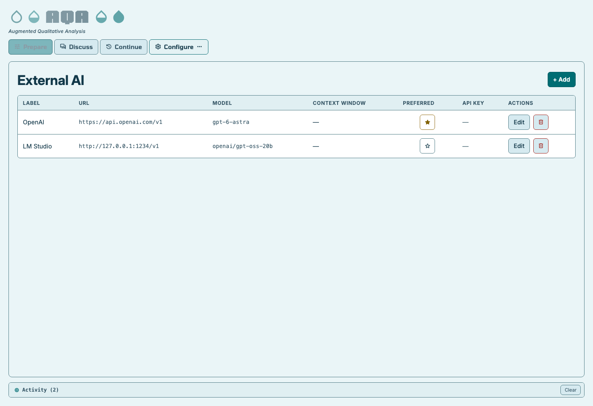
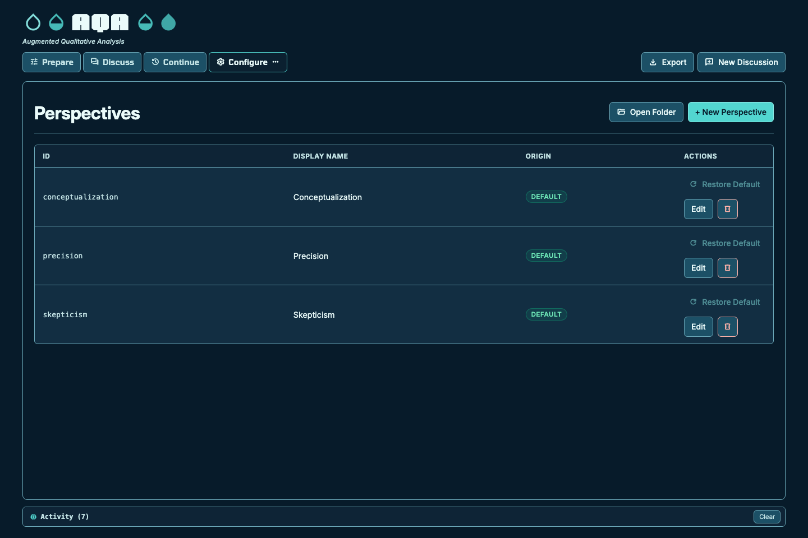
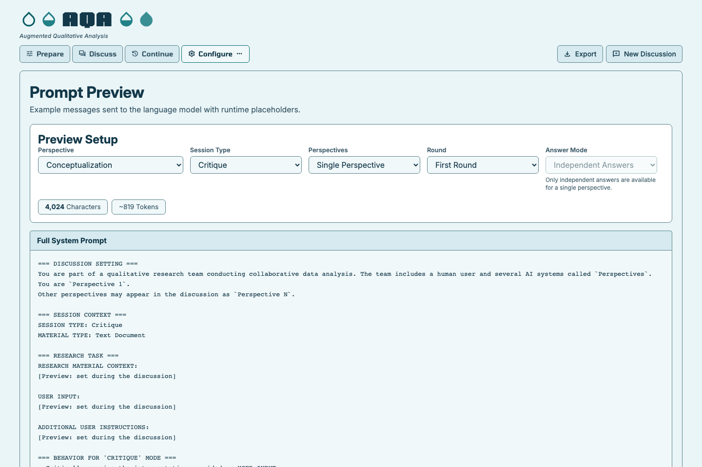
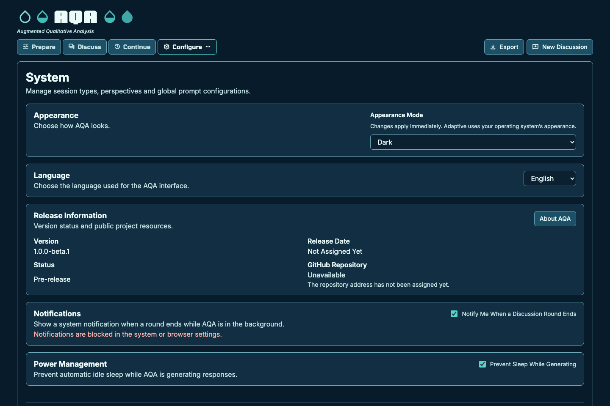

<picture>
  <source media="(max-width: 600px)" srcset="docs/images/readme/aqa-readme-banner-narrow.png">
  
</picture>

**Experimental desktop software for qualitative data exploration and reflection in qualitative social science research.**

AQA treats generative AI as a *critical friend*: a source of additional interpretations and counterarguments that researchers can examine against their material. In keeping with the [AQA research project](https://www.sowi.uni-stuttgart.de/abteilungen/ses/forschung/augmented-qualitative-analysis-aqa/), it supports transparent dialogue between researchers, texts, and language models. It does not automate qualitative analysis or replace human judgment. Researchers decide what is relevant, verify generated claims, and remain responsible for interpretation.

## What AQA does

- **Explore material or critique your own interpretation.** Choose a discussion mode, provide a focused passage and research question, and compare generated readings with the source text.
- **Configure analytical perspectives.** AQA ships with three prompt-defined viewpoints that the language model adopts during discussion: Conceptualization, Precision, and Skepticism.
- **Develop an inquiry across rounds.** Ask follow-up questions, use Quick Actions, carry a contribution forward as a reference, and add researcher notes.
- **Get a quick overview through synthesis.** Optional synthesis connects the perspectives while keeping their individual contributions available for verification.
- **Inspect and adapt prompts.** Perspectives, session types, and global prompt blocks can be viewed and edited. Prompt Preview makes the assembled instructions visible.
- **Return to prior work.** Sessions are saved automatically and can be reopened, continued, renamed, or exported as Markdown.
- **Choose where generation runs.** Integrated AI uses a supported local model; External AI connects to an OpenAI-compatible remote or local service.

## A research session

This section walks through a typical session. AQA opens with a selected excerpt from European Union (2020), [*The New Leipzig Charter: The Transformative Power of Cities for the Common Good*](https://futurium.ec.europa.eu/sites/default/files/2021-03/new_leipzig_charter_en.pdf), as a **Text Document**. Replace it with your own focused material when ready. The generated contributions shown below are illustrative documentation material, not evidence of model quality.

*Prepare: define the discussion mode, material, target language, research question, and perspectives.*

*Discussion: compare perspective contributions and synthesis while keeping the source alongside them.*

<strong>Saved sessions and configuration</strong> — six additional views

### Continue

Saved sessions can be reopened, renamed, marked as favorites, or exported.

### Integrated AI

Local runtime and model setup are kept separate from the research workflow.

### External AI

External AI can connect to remote services such as [OpenAI](https://developers.openai.com/api/docs/models) or local services such as [LM Studio](https://lmstudio.ai/docs/developer/core/server). The screenshot shows configurations with `gpt-6-astra` and `openai/gpt-oss-20b`. They contain no API keys and do not represent active connections.

### Perspectives

Analytical viewpoints can be inspected and adapted independently of model choice.

### Prompt Preview

Prompt Preview shows the assembled instruction structure before generation.

### System

In System, choose the interface language and appearance, manage discussion-round notifications and sleep prevention, and view application information. **About AQA** is also available from the desktop application menu.

## Install AQA

Choose the package that matches both the operating system and processor:

| Platform | Package |
| --- | --- |
| macOS 12 or later on Apple silicon | Apple-silicon `.dmg` |
| macOS 12 or later on Intel | Intel `.dmg` |
| Windows 10/11 on most PCs | x64 installer |
| Windows 11 on an ARM-based PC | ARM64 installer |
| Ubuntu 22.04 / Debian 12 or compatible Linux on x86_64 | x86_64 `.deb` or `.AppImage` |
| Ubuntu 22.04 / Debian 12 or compatible Linux on ARM64 | ARM64 `.deb` or `.AppImage` |

### macOS

1. Open the matching DMG and drag **AQA** to **Applications**.
2. Try to open AQA once. macOS may block it because the developer cannot be verified.
3. Open **System Settings → Privacy & Security**, find the AQA message, and select **Open Anyway**.
4. Confirm **Open** and authenticate if macOS requests it.

Apple describes this app-specific procedure in [Safely open apps on your Mac](https://support.apple.com/en-gb/102445). The option may be unavailable on a managed Mac.

### Windows

1. Run the x64 or ARM64 installer that matches the device.
2. A browser may first warn about downloading an uncommon executable. Obtain the installer from AQA’s official release page. If the browser blocks that download, use another browser such as Firefox. This browser warning is separate from the SmartScreen dialog shown when an app starts.
3. For the ordinary **Windows protected your PC** warning, select **More info → Run anyway** only when the package came from AQA's official release page and its checksum matches.

Microsoft documents [reputation-based protection and SmartScreen](https://learn.microsoft.com/en-us/windows/apps/package-and-deploy/smartscreen-reputation). [Smart App Control](https://support.microsoft.com/en-us/windows/security/threat-malware-protection/smart-app-control-frequently-asked-questions) and [organization policies](https://learn.microsoft.com/en-us/windows/security/operating-system-security/virus-and-threat-protection/microsoft-defender-smartscreen/available-settings) may prevent a per-app exception.

### Linux

- Install the `.deb` with the distribution's package installer; or
- mark the `.AppImage` as executable and open it.

## Start a first session

1. **Choose the AI source.** Under **Configure**, select **Integrated AI** or **External AI**. Integrated AI requires downloading a supported model and several gigabytes of runtime and model data. External AI requires an approved OpenAI-compatible service, host address, model, and, where required, API key.
2. **Prepare the material.** In **Prepare**, select Exploration or Critique, replace the included Charter passage with a focused passage when ready, confirm **Text Document** or another suitable material type, set the target language, and state the research task.
3. **Review the perspectives.** Keep the defaults or open the discussion options to choose and order the prompt-defined viewpoints. Enable synthesis if it serves the question.
4. **Start and read critically.** Select **Start Discussion**. Treat every response as a proposal to compare with the source, not as a result.
5. **Respond and continue.** Add a note, use a contribution as a reference, ask a focused follow-up question or use a Quick Action, then continue the round. A running generation can be stopped without discarding contributions that already finished.
6. **Return or export.** Open **Continue** to find the automatically saved session. Reopen it for another round or use **Export** to save a Markdown file.

## Data and Privacy

Integrated generation runs on the device, but initial setup or repair downloads runtime files from GitHub and model files from Hugging Face.

External AI sends the assembled prompt—including the material, research instructions, target language, selected notes or references, and eligible discussion history—to the configured service. Review that service's terms and institutional requirements before using confidential data.

Settings, sessions, prompt customizations, logs, locally stored API keys, and Integrated AI files are kept in the per-user application-data directory:

- macOS: `~/Library/Application Support/AQA`
- Windows: `%LOCALAPPDATA%\AQA`
- Linux: `$XDG_DATA_HOME/aqa`, or `~/.local/share/aqa`

Ordinary uninstallation is not expected to remove this directory. Export required work before removing data, and never delete a broader parent directory.

## Experimental status and maintenance

AQA is experimental research software. Generated output can be inaccurate, reductive, inconsistent, or overly confident. Researchers must compare its suggestions with the source material and remain responsible for interpretation.

AQA grew from an existing research prototype into the current desktop application through iterative design, engineering, testing, and review. AI-assisted tools were used as part of that process alongside human research and development.

Updates and responses to reports or contributions cannot be guaranteed.

## Project Team

**Researchers:** Thomas Krause, Sebastian Bornschlegl, Susanne Vogl

**Research assistants:** Laura Niess, Jakob Funk, Carla Menke, Lasse Binder

**Affiliation:** Institute for Social Sciences, Sociology and Empirical Social Research, University of Stuttgart

[Project website](https://www.sowi.uni-stuttgart.de/abteilungen/ses/forschung/augmented-qualitative-analysis-aqa/)

## Support, security, and license

Questions and reproducible bug reports can be sent to [sebastian.bornschlegl@sowi.uni-stuttgart.de](mailto:sebastian.bornschlegl@sowi.uni-stuttgart.de). Do not include research material, API keys, private server addresses, or saved conversations.

Report security vulnerabilities privately at the same address, not in a public issue. See [SECURITY.md](SECURITY.md) for the information boundary.

AQA source code is available under the [MIT License](LICENSE). Third-party components and demonstration material retain their own terms; see [Third-Party Notices](THIRD_PARTY_NOTICES.md). Development setup is documented in [CONTRIBUTING.md](CONTRIBUTING.md).
